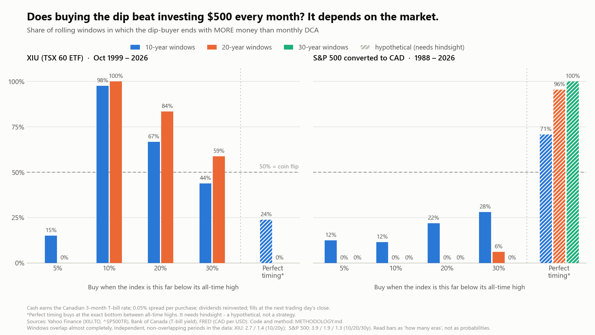
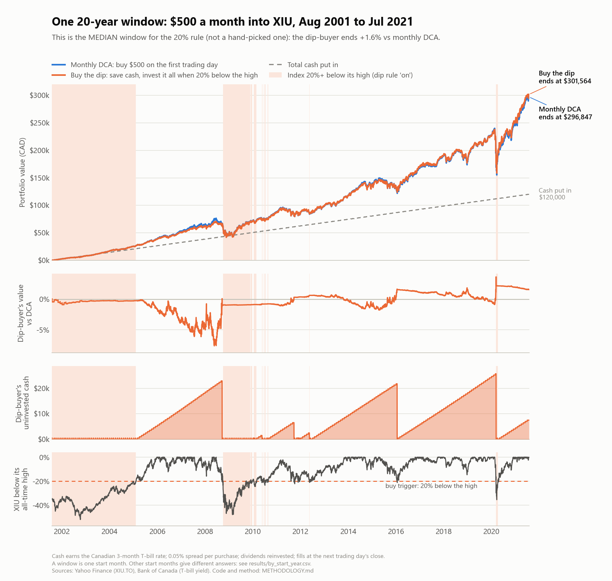
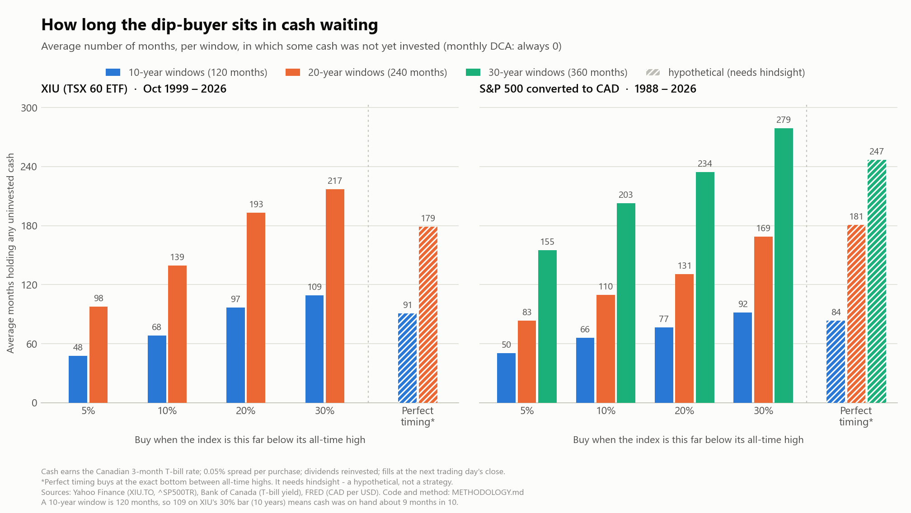
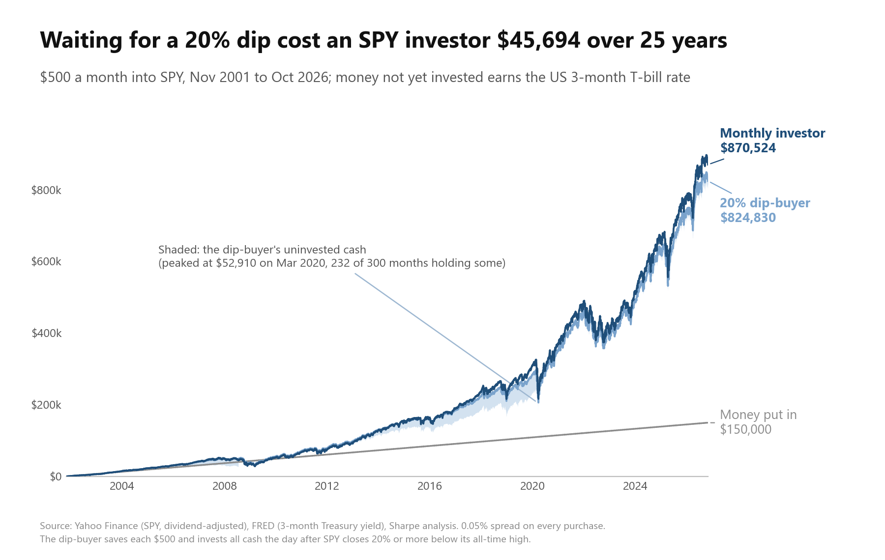
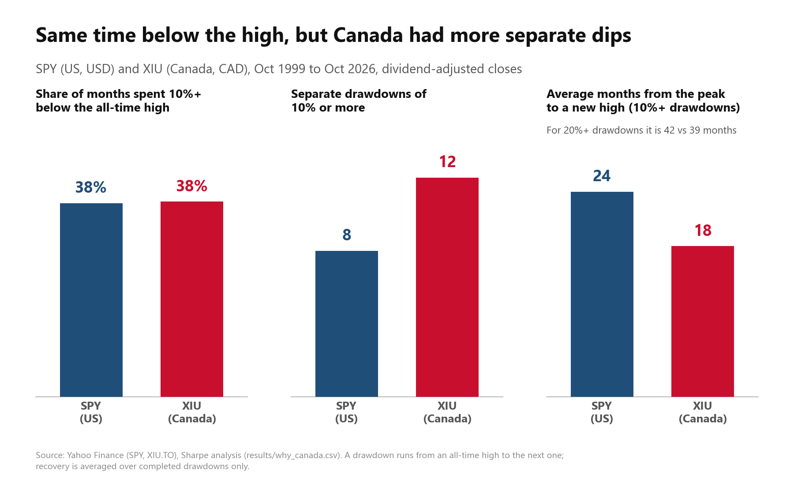
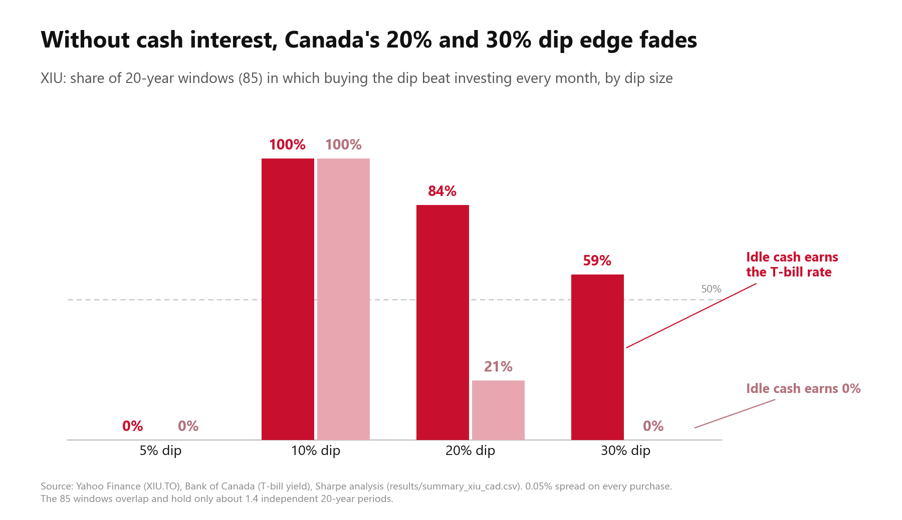

# Does "buying the dip" beat investing every month?

**Sharpe, study 1.** A public, reproducible test of "buy the dip" against plain monthly investing (dollar-cost
averaging, "DCA") on real market data. Open code, every assumption written down, and every number in this README
traces to a CSV in [`results/`](results/).

> Educational research, not investment advice. Past results do not predict the future.

[](https://github.com/Sharpe123321/sharpe-buy-the-dip-vs-dca/actions/workflows/tests.yml)

**Jump to:** [The question](#the-question) ·
[The short answer](#the-short-answer) ·
[The six charts](#the-six-charts) ·
[Results tables](#results-tables) ·
[Why was Canada different?](#why-was-canada-different) ·
[Sanity check vs Maggiulli](#sanity-check-against-maggiulli-not-reproduced) ·
[Reproduce it](#reproduce-it) ·
[Repository map](#repository-map) ·
[Building on this](#building-on-this) ·
[Troubleshooting](#troubleshooting) ·
[How we know the code is right](#how-we-know-the-code-is-right) ·
[Data and licensing](#data-and-licensing) ·
[Limitations](#limitations)

## The question

An investor puts **$500 of new money into the market every month**. Is it better to

- **invest it immediately, every month** (DCA), or
- **hold it in cash and invest everything held when the market closes X% below its all-time high** ("buy the dip")?

A third, hypothetical strategy, **perfect timing** (invest only at the exact lowest close between two all-time
highs), is included as a ceiling. It needs hindsight, so nobody can actually do it.

## The short answer

**It depends on the market and the period, and the data cannot give one answer.**

- **US stocks (SPY, last 25 years): waiting for the dip lost at every size tried.** $500 a month from Nov 2001 to
  Oct 2026 ($150,000 put in) ended at **$870,524** investing monthly versus **$824,830** waiting for a 20% dip
  (**-5.2%**). The dip-buyer held some uninvested cash in 232 of 300 months.
- **Canadian stocks (XIU, 1999-2026): a small, fragile edge for the dip-buyer.** A 10% dip beat monthly investing in
  **98%** of 10-year and **100%** of 20-year windows, but only by a median of **+1.1% to +1.2%** in ending wealth.
  Perfect timing, with hindsight, *lost* to DCA by about 3.5% (it won in only 24% of 10-year and 0% of 20-year
  windows).
- **The S&P 500 converted to CAD (1988-2026): the opposite.** Buy-the-dip beat monthly investing in **12% to 28%** of
  10-year windows and in **0% to 6%** of 20- and 30-year windows. The median dip-buyer finished anywhere from
  **0.4% behind (5% dip, 20 years) to 21% behind (30% dip, 30 years)**, because the market kept rising while the
  cash waited.
- **The Canadian edge is fragile.** A 20% dip wins 84% of XIU's 20-year windows, but only 21% if idle cash earns 0%
  instead of the T-bill rate. The 10% result survives that change; the 20% and 30% results do not. It also moves by
  tens of points depending on how dividends are counted and whether dips are read from price or total return.
- **We do not know why Canada differed.** SPY and XIU spent the same share of time below their highs and had the
  same number of 20%+ crashes. Simple market statistics do not explain the gap. Confidence that it is explained: low
  ([details](#why-was-canada-different)).
- **Waiting costs a lot of time in cash.** A 20% dip-buyer sat on cash for an average of **97 of 120 months**
  (XIU, 10 years) and **131 of 240 months** (S&P 500, 20 years).
- **The sample is tiny.** The windows overlap almost completely. XIU's history holds about **2.7 independent
  10-year periods and 1.4 independent 20-year periods**. Read the percentages as "how many eras", not as
  probabilities.

Nothing here says buy-the-dip is a good idea or a bad one. It says the answer swings with the market, and that a rule
which sounds clever mostly just holds cash longer.

## The six charts

Charts 1-3 come from the main study (Canada, and the S&P 500 converted to Canadian dollars) and are built by
`scripts/make_charts.py`. Charts 4-6 come from the follow-up work (a simplified SPY-only run and a SPY-vs-XIU
comparison) and are built by `scripts/newsletter_charts.py`. The CSV behind each chart is named under it.

### Chart 1. How often does the dip-buyer win?



**What it shows.** For each dip size (5% to 30%), the share of rolling 10-, 20- and (S&P 500 only) 30-year windows in
which the dip-buyer ended with more money than the monthly investor. Left: XIU, the iShares S&P/TSX 60 ETF. Right: the
S&P 500 converted to Canadian dollars. The hatched bars on the right of each panel are perfect timing, a
hindsight-only hypothetical. The dashed line at 50% is a coin flip.

**Key numbers.**
- XIU: a 10% dip beat DCA in 98% of 10-year and 100% of 20-year windows. At 5%: 15% / 0%. At 20%: 67% / 84%. At 30%:
  44% / 59%.
- S&P 500 in CAD: 12% / 12% / 22% / 28% of 10-year windows at 5 / 10 / 20 / 30%, and 0% of 20- and 30-year windows
  (one exception: 6% at the 30% dip over 20 years).
- Perfect timing beat DCA in 24% of XIU's 10-year windows and 0% of its 20-year windows, but in 71% / 96% / 100% of
  the S&P 500's 10 / 20 / 30-year windows.

**Read it with care.** A bar says *how often*, not *by how much*: XIU's median gain at the 10% dip is only about +1%
(see chart 6). The windows overlap almost completely, so "100%" means "in the one or two eras this data contains".

*Data:* [`results/headline_table.csv`](results/headline_table.csv), [`results/summary_xiu_cad.csv`](results/summary_xiu_cad.csv),
[`results/summary_sp500_cad.csv`](results/summary_sp500_cad.csv).

### Chart 2. One real 20-year window



**What it shows.** XIU from Aug 2001 to Jul 2021: the **median** window for the 20% rule, not a hand-picked one. From
the top: both portfolios' value, the dip-buyer's value relative to DCA, the dip-buyer's uninvested cash, and how far
XIU sat below its all-time high against the 20% trigger. Shaded stripes mark the days the rule was "on".

**Key numbers.** On $120,000 put in, DCA ends at **$296,847** and the dip-buyer at **$301,564** (+1.6%). The dip-buyer
was fully invested from 2001 to early 2005 (XIU was 20%+ below its high for that whole stretch), then piled up cash
from March 2005 until it invested **$22,914** at once on 18 Sep 2008. Along the way it trailed DCA by as much as
**7.6%** (May 2008). Later lump-sum purchases: $21,782 in Jan 2016 and $25,710 in Mar 2020.

**Read it with care.** The sawtooth in the cash panel is the whole strategy: cash builds at $500 a month, then is
spent in one go. Whether the dip-buyer is ahead at the end depends on whether its last big purchase happened to come
near a low. This is one start month; other start months give different answers
([`results/by_start_year.csv`](results/by_start_year.csv)).

*Data:* [`results/by_start_year.csv`](results/by_start_year.csv). The per-window detail is not published (see
[Data and licensing](#data-and-licensing)); `scripts/run_study.py` writes it to the git-ignored `local_only/` folder.

### Chart 3. How long the dip-buyer waits in cash



**What it shows.** The average number of months, per window, in which the dip-buyer held *any* uninvested cash. Monthly
DCA is always zero.

**Key numbers.**
- XIU, 20% dip: **97 of 120** months in 10-year windows and **193 of 240** months in 20-year windows.
- S&P 500 in CAD, 30% dip: **279 of 360** months over 30 years. Even the 5% dip left that investor in cash for 155 of
  360 months.

**Read it with care.** A month counts if any cash was held, however small the amount. Idle cash earns the Canadian
3-month T-bill rate in these runs, so waiting is not free money lost, but it is money not in the market.

*Data:* [`results/headline_table.csv`](results/headline_table.csv) (`avg_months_in_cash`).

### Chart 4. $500 a month into SPY for 25 years



**What it shows.** SPY from Nov 2001 to Oct 2026, $500 a month. Dark blue is the monthly investor, light blue is the
20% dip-buyer, grey is the total money put in, and the pale shading under the dip-buyer's line is the cash it was
holding uninvested. Idle cash earns the US 3-month T-bill rate.

**Key numbers.** The monthly investor ends at **$870,524**, the 20% dip-buyer at **$824,830**, a gap of **$45,694** on
$150,000 put in. The dip-buyer made 75 purchases (against 300 deposits) and held some cash in 232 of 300 months. Its
cash pile peaked at **$52,910** on 12 Mar 2020, the day SPY closed 26.7% below its high; it was invested at the next
close, 13 Mar. Even so, it finished behind.

**Read it with care.** This is one 25-year path, not a distribution. Across every 10-year window inside it, the
20% dip-buyer beat DCA in only 20% of windows (median -9.5%); see [Results tables](#results-tables). SPY's Yahoo history
is noisier than the index before 2009; the same run on the S&P 500 total-return index gives the same conclusion within
0.4 percentage points ([METHODOLOGY section 10.1](METHODOLOGY.md)).

*Data:* [`results/spy_25y.csv`](results/spy_25y.csv). The day-by-day series behind the chart are **not** published,
because a portfolio's daily value lets anyone work back to the underlying price history (see
[Data and licensing](#data-and-licensing)). `scripts/newsletter_charts.py` writes them to the git-ignored `local_only/` folder.

### Chart 5. Why was Canada different?



**What it shows.** Three numbers for the S&P 500 fund SPY (blue, US) and the Canadian fund XIU (red), Oct 1999 to Oct
2026: the share of months spent 10%+ below the all-time high, the number of separate 10%+ drawdowns, and the average
months from a peak to the next new high.

**Key numbers.** Time below the high: **38% vs 38%**. Separate 10%+ drawdowns: **8 vs 12**. Average months to recover
a 10%+ drawdown: **24 vs 18** (for 20%+ drawdowns: 42 vs 39).

**Read it with care.** This chart is the *reason it is hard to explain*: on time spent below the high the two markets
are identical, and the 20%+ crash count is also identical (4 vs 4). The longer SPY recovery time is mostly arithmetic:
XIU has eight shallow drawdowns (10-16%) against SPY's two, and most of those healed fast, which pulls its average
down. See [Why was Canada different?](#why-was-canada-different).

*Data:* [`results/why_canada.csv`](results/why_canada.csv), [`results/why_canada_windows.csv`](results/why_canada_windows.csv).

### Chart 6. How fragile is the Canadian edge?



**What it shows.** For XIU, the share of the 85 twenty-year windows in which the dip-buyer beat monthly investing, at
each dip size, with idle cash earning the T-bill rate (dark red) versus earning nothing (light red).

**Key numbers.**

| Dip | Cash earns T-bill | Cash earns 0% |
|---|---:|---:|
| 5% | 0% | 0% |
| 10% | 100% | 100% |
| 20% | 84% | 21% |
| 30% | 59% | 0% |

**Read it with care.** The 10% result is robust to this assumption; the 20% and 30% results are not, so most of
the larger-dip "edge" in Canada is interest on cash, not good timing. The 85 windows overlap and hold only about 1.4
independent 20-year periods.

*Data:* [`results/summary_xiu_cad.csv`](results/summary_xiu_cad.csv) (`cash_mode` = `tbill` or `zero`).

## Results tables

### Main study, primary settings (Canada and S&P 500 in CAD)

Cash earns the Canadian 3-month T-bill yield, 0.05% spread on every purchase, dividends reinvested, buy at the next
trading day's close, nominal CAD. "Median diff" is the dip-buyer's ending value versus monthly DCA, in percent.

| Asset | Horizon | Windows | Dip | Beats monthly | Median diff | Worst | Best |
|---|---|---:|---|---:|---:|---:|---:|
| XIU | 10y | 205 | 5% | 15% | -0.2% | -2.1% | +0.1% |
| XIU | 10y | 205 | 10% | 98% | +1.1% | -0.6% | +2.8% |
| XIU | 10y | 205 | 20% | 67% | +1.4% | -16.1% | +7.2% |
| XIU | 10y | 205 | 30% | 44% | -1.4% | -29.1% | +8.1% |
| XIU | 20y | 85 | 5% | 0% | -0.3% | -0.8% | -0.1% |
| XIU | 20y | 85 | 10% | 100% | +1.2% | +0.6% | +1.7% |
| XIU | 20y | 85 | 20% | 84% | +1.6% | -1.8% | +2.7% |
| XIU | 20y | 85 | 30% | 59% | +0.4% | -6.3% | +2.8% |
| S&P 500 (CAD) | 10y | 346 | 5% | 12% | -0.6% | -6.1% | +0.4% |
| S&P 500 (CAD) | 10y | 346 | 10% | 12% | -5.9% | -47.2% | +0.7% |
| S&P 500 (CAD) | 10y | 346 | 20% | 22% | -13.5% | -59.6% | +4.6% |
| S&P 500 (CAD) | 10y | 346 | 30% | 28% | -17.7% | -64.0% | +14.4% |
| S&P 500 (CAD) | 20y | 226 | 5% / 10% / 20% / 30% | 0% / 0% / 0% / 6% | -0.4% / -3.8% / -8.9% / -15.0% | | |
| S&P 500 (CAD) | 30y | 106 | 5% / 10% / 20% / 30% | 0% in all four | -2.1% / -19.7% / -20.2% / -21.1% | | |

**Perfect timing** (a hypothetical that needs hindsight) *beat* DCA in only 24% of XIU's 10-year windows and 0% of its
20-year windows (median -3.6% / -3.4%), and beat it in the S&P 500 in 71% / 96% / 100% of 10 / 20 / 30-year windows.
Even a perfect market timer has no stable edge over DCA across these two markets.

Every cash, cost and rule variant: [`results/tables.md`](results/tables.md) and `results/summary_*.csv`. Sensitivity
table: [METHODOLOGY section 9](METHODOLOGY.md).

### SPY only, last 25 years (simplified rerun)

$500 a month into SPY, Nov 2001 to Oct 2026, idle cash in the US 3-month T-bill, 0.05% spread. Dip sizes here are
5 / 10 / 15 / 20% (the main study used 5 / 10 / 20 / 30%, so the two tables are not like-for-like).

| Dip | Ending value | vs monthly DCA | Months holding cash (of 300) | Purchases | 10-year windows where the dip-buyer wins (181) | Median 10-year difference |
|---|---:|---:|---:|---:|---:|---:|
| Monthly DCA | $870,524 | | 0 | 300 | | |
| 5% | $868,214 | -0.3% | 135 | 186 | 29% | -0.8% |
| 10% | $851,700 | -2.2% | 183 | 133 | 8% | -3.7% |
| 15% | $835,980 | -4.0% | 209 | 101 | 18% | -6.1% |
| 20% | $824,830 | -5.2% | 232 | 75 | 20% | -9.5% |

Side-by-side with the XIU results: [`results/spy_vs_xiu.md`](results/spy_vs_xiu.md). Full detail, including a
cross-check on the S&P 500 total-return index: [`results/spy_25y.csv`](results/spy_25y.csv).

## Why was Canada different?

In the main study the S&P 500 (in CAD) behaves like SPY: dip-buyers lose almost everywhere. XIU is the odd one out. So
the split looks like *XIU versus the S&P 500*, not US dollars versus Canadian dollars. We checked whether the obvious
market-level statistics explain it (SPY and XIU over their shared period, Oct 1999 to Oct 2026):

| | SPY (US, USD) | XIU (Canada, CAD) |
|---|---:|---:|
| Annualised total return | 8.57% | 8.84% |
| Share of month-ends 10%+ below the high | 37.8% | 38.2% |
| Separate drawdowns of 10%+ / of 20%+ | 8 / 4 | 12 / 4 |
| Average months, peak to new high (10%+ / 20%+ drawdowns) | 24.1 / 41.6 | 17.7 / 39.1 |

**Does this explain the difference? Mostly no.** The two markets spent the same share of time below their highs, had
the same number of 20%+ crashes and earned similar returns, so "Canada simply grew slower or crashed less" is out. The
one clear difference is XIU's larger number of shallow 10-16% drawdowns.

On 181 ten-year windows, the 10% dip-buyer's average result versus DCA was **-3.9% for SPY and +1.3% for XIU**, a gap
of 5.2 points. Time spent below the high accounts for only **about 3%** of that gap, and the same variable even points
in opposite directions in the two markets (correlation +0.71 in SPY's windows, -0.54 in XIU's). The number of separate
10%+ dips accounts for about **28%**, but that was a second candidate tried *after* the first failed, on overlapping
windows from two markets, so it is a lead and not a finding.

**Confidence that the question is answered: low.** Untested conjectures include the timing of crashes relative to
deposits, XIU's sector mix, the Canadian versus US T-bill rate, and plain chance (two markets, overlapping eras).
Definitions and the full output: [METHODOLOGY section 10.2](METHODOLOGY.md).

## Sanity check against Maggiulli: not reproduced

The brief expected that on a long US history DCA would beat perfect timing in roughly 70% of periods, as in Nick
Maggiulli's "Even God Couldn't Beat Dollar-Cost Averaging". **We did not reproduce that.** On US data from 1926
(0% cash, no costs) perfect timing *beat* DCA in 45-59% of 40-year windows in nine of ten variants (nominal or
inflation-adjusted, month-end or monthly-average prices, two definitions of the bottom). The tenth gave 31%, which
we treat as a coincidence because the same data in real terms gives 45%. His threshold-rule
results (2021 post, about 25% at 10-20%) are matched more closely (28% / 16% in the closest variant). We have not
established why the perfect-timing figure differs; likely candidates are the exact strategy definition and the data
series, and none is confirmed. The engine's correctness rests on its tests, not on matching his number. Details:
[METHODOLOGY section 6](METHODOLOGY.md) and [`results/sanity_check_maggiulli.csv`](results/sanity_check_maggiulli.csv).

## Reproduce it

Python 3.10 or newer, and an internet connection (the code downloads its data on the first run).

```bash
git clone https://github.com/Sharpe123321/sharpe-buy-the-dip-vs-dca.git
cd sharpe-buy-the-dip-vs-dca
python -m venv .venv
source .venv/bin/activate          # Windows: .venv\Scripts\activate
pip install -r requirements.txt
python run_all.py                  # data audit -> tests -> sanity check -> study -> charts -> tables -> follow-ups
```

The run stops at the first failure, so no number is produced from a failed audit or a failing test. The test suite
alone takes about two minutes. If you want to import the code from your own scripts, install it instead with
`pip install -e ".[test]"` (see [Building on this](#building-on-this)).

To rerun only parts:

```bash
python -m pytest -q tests          # 52 tests on synthetic data (no network); 7 more check the real data
                                   # and are skipped until run_all.py has downloaded it
python scripts/spy_25y.py          # SPY-only 25-year run, about 3 seconds once data is cached
python scripts/why_canada.py       # SPY vs XIU comparison
python scripts/newsletter_charts.py  # charts 4-6 (reads results/why_canada.csv and summary_xiu_cad.csv)
python scripts/check_no_raw_data.py  # confirms no provider data is in the repo (run after run_all.py)
```

`python run_all.py --refresh` deletes the cache and re-downloads every input.

**What has been tested.** On 2026-11-15, from a fresh clone on Windows 11:

| Python | pandas / numpy | What ran | Result |
|---|---|---|---|
| 3.10 | 2.3.3 / 2.2.6 (the versions in `requirements-lock.txt`) | full `python run_all.py`, twice | all 59 tests and every step passed, about 3 minutes |
| 3.13 | 3.1.1 / 2.5.5 (the newest pip resolves today) | full `python run_all.py` | all 59 tests and every step passed, under 4 minutes |
| 3.11 and 3.14 | 3.1.1 / 2.4.6 and 2.5.5 | test suite and both examples | 59 of 59 tests passed, examples ran |

The 3.10 and 3.13 runs reproduced the published results: every win rate and median in `headline_table.csv` to within
0.05 percentage points, and the SPY dollar values to within a few cents. GitHub Actions also runs the offline tests and
an example on Linux, macOS and Windows for every push. **Not tested by the author: the full pipeline on macOS or Linux**
(only those offline tests run there).

**If you run it later, expect small differences**, because the study uses whatever the data providers serve that day:

- Dollar values shift a little each time a fund pays a dividend and Yahoo restates its adjusted history. When we scaled
  SPY's history by -0.4% to simulate that, the dollar values rose about 0.4% and the percentage gaps moved by hundredths
  of a point.
- `scripts/spy_25y.py` covers the *last 25 complete years*, so its window rolls forward each month and its numbers and
  chart dates follow. `scripts/why_canada.py` is pinned to the published cut-off (`AS_OF` in the script) so the SPY-vs-XIU
  comparison stays like-for-like; edit it to roll forward.
- Window counts (205, 85, ...) grow with the data you download.
- The Kenneth French library has added two months since the published sanity check; its win rates move by up to
  0.16 percentage points, with the same conclusion.
- `requirements-lock.txt` pins the library versions used for the published results.

## Repository map

```
README.md              this page
METHODOLOGY.md         data, sources, every assumption, verification, limitations, follow-up analyses
LICENSE                MIT
run_all.py             one command reruns everything
src/dipdca/
  data.py              loaders (Yahoo, Bank of Canada, FRED, Fama/French), total-return and cash maths
  assets.py            builds the XIU, S&P 500 (CAD) and US sanity-check series
  engine.py            the strategies and exact per-window valuation (vectorised)
  reference.py         slow day-by-day twin of the engine (tests, example-window chart, SPY path)
  study.py             rolling windows, win rates, differences, months in cash
scripts/
  audit_data.py        39 data-quality checks               -> results/data_audit*
  sanity_check.py      the Maggiulli replication attempt    -> results/sanity_check_*
  run_study.py         the main study                       -> results/summary_*, headline_table, by_start_year, ...
  make_charts.py       charts 1-3                           -> charts/1_*, 2_*, 3_*
  make_tables.py       tables for the docs                  -> results/tables.md
  spy_25y.py           SPY-only 25-year run                 -> results/spy_25y.csv
  why_canada.py        SPY vs XIU comparison                -> results/why_canada*.csv
  newsletter_charts.py charts 4-6                           -> charts/chart_*  (+ local-only series in local_only/)
  check_no_raw_data.py guard: fails if any provider data is in the repo
examples/              two runnable examples: the engine in 20 lines, and the comparison on your own prices
tests/                 59 tests (52 on synthetic data; 7 check the real data once it is cached)
.github/workflows/     offline tests on Linux, macOS and Windows for every push
results/               every CSV and table behind the numbers; see results/README.md for each file's columns
charts/                the six PNGs above
```

## Building on this

Install the package once and import it from any folder:

```bash
pip install -e ".[test]"
```

Two runnable examples are in [`examples/`](examples/):

- [`quickstart.py`](examples/quickstart.py): scores buy-the-dip against monthly DCA on XIU using the engine directly
  (about 20 lines). It prints the 98% from the results table above.
- [`bring_your_own_prices.py`](examples/bring_your_own_prices.py): runs the same comparison on **your own price
  series**. It makes up random prices so it runs offline; replace that block with your own data.

Where to change things:

| To add | Change |
|---|---|
| another asset | build a `Market` (see the second example), or add a function like `xiu_cad()` in [`src/dipdca/assets.py`](src/dipdca/assets.py) and list it in `scripts/run_study.py` |
| another data source | a loader in [`src/dipdca/data.py`](src/dipdca/data.py); `load_yahoo`, `load_fred` and `load_boc` are the models |
| a new strategy | a new `Strategy` kind in [`src/dipdca/engine.py`](src/dipdca/engine.py) **and** the matching branch in the slow reference simulator [`src/dipdca/reference.py`](src/dipdca/reference.py); the tests check that the two agree |
| a new check | [`tests/`](tests/); `tests/helpers.py` builds synthetic markets |

Keep the rule that nothing derived from a data provider's series goes into the repository (see
[Data and licensing](#data-and-licensing)); `python scripts/check_no_raw_data.py` checks it.

## Troubleshooting

- **A download fails.** Yahoo, FRED, the Bank of Canada and Dartmouth are public services that sometimes refuse or throttle
  automated requests. Each fetch retries three times, then stops with the address it could not read. Wait and rerun: files
  already downloaded stay in `data/cache/`. Do not use `--refresh` while a source is down, because it deletes the cache first.
- **The Dartmouth (Fama/French) server refuses to connect.** Only the data audit and the Maggiulli sanity check use it,
  but the audit is the first step of `run_all.py`. Download `F-F_Research_Data_Factors_CSV.zip` and
  `F-F_Research_Data_Factors_daily_CSV.zip` from the
  [Kenneth French data library](https://mba.tuck.dartmouth.edu/pages/faculty/ken.french/data_library.html) and save them in
  `data/cache/` as `french_F-F_Research_Data_Factors_CSV.zip` and `french_F-F_Research_Data_Factors_daily_CSV.zip`.
  This happened once while building the study. The main study, the SPY-only run and the charts do not need it:
  `python scripts/run_study.py`, `python scripts/spy_25y.py`.
- **`pip install` fails on Windows with "No such file or directory".** The folder is nested too deeply: Windows limits
  paths to 260 characters, and `yfinance` pulls in packages with long file names. Clone into a short path such as `C:\src\`.
- **The charts look slightly different.** The scripts ask for the Segoe UI font (Windows) and fall back to DejaVu Sans
  elsewhere. The text is wider, a few labels sit closer together, and all six charts stay legible (we rendered them with
  DejaVu Sans only).
- **7 tests are skipped.** They check the real downloaded data. Run `python run_all.py` once and they run.

## How we know the code is right

- **59 tests**, including: no look-ahead (cutting the history never changes an earlier fill; perfect timing is the
  deliberate control that *does* fail), cash accounting (money spent plus cash left equals contributions), dividend
  handling, and the fast engine matching a deliberately slow day-by-day simulator to 1e-9 on over 5,000 random paths
  and to about 4e-15 on real data.
- **A second, separately written implementation** (not included in this repository) agreed with the engine to 1.3e-15
  over 8,640 real-data comparisons once both used the same fill convention. The only difference it exposed is
  documented as an assumption.
- **Mutation testing:** nine deliberate bugs were injected into the engine and data code, and the suite failed on every
  one.
- **A 39-check data audit** on every run (gaps, stale prices, outliers, cross-checks against independent series):
  0 FAIL ([`results/data_audit.md`](results/data_audit.md)).

The two follow-up runs (SPY-only, why-Canada) reuse the same engine and have lighter checks of their own, described in
[METHODOLOGY section 10](METHODOLOGY.md).

## Data and licensing

**No third-party market data is published here.** The code fetches each series from its public source at run time
into `data/cache/` (git-ignored). Everything in `results/` is our own derived output: strategy outcomes, win rates
and drawdown statistics, not prices, index levels or interest rates. The charts are images of those results.

**Series-like files are deliberately left out**: day-by-day or month-by-month portfolio values, and the per-window
detail file. From a portfolio's daily value anyone can rebuild the underlying price series, and consecutive windows'
ending values reproduce month-end returns. We confirmed this on earlier versions of this repository: SPY's daily
returns came back to within 1e-6 from the daily file, and XIU's month-end returns came back with 0.998 correlation
from the per-window file. Those files were removed and are generated locally into the git-ignored `local_only/`
folder instead. [`scripts/check_no_raw_data.py`](scripts/check_no_raw_data.py) tests the repository and
its full git history for exact copies of provider files, verbatim provider numbers and hidden provider series.

| Source | Terms to know |
|---|---|
| Yahoo Finance via `yfinance` (XIU.TO, SPY, ^SP500TR) | `yfinance` says Yahoo's API is "intended for personal use only". Fetching at run time is the usual workaround, not a licence. **Check Yahoo's terms before using the data commercially.** |
| Bank of Canada Valet API (T-bill yield) | May be reused with attribution to the Bank of Canada; if you sell content that includes it you must tell buyers it is freely available from the Bank. |
| FRED (CAD/USD, IMF T-bill rate, US 3-month T-bill, US CPI) | Federal Reserve and BLS series; check each series' notes on FRED. |
| Kenneth French Data Library | Cite Fama and French (US market returns and T-bill rate; sanity check only). |

Code and documentation are released under the [MIT licence](LICENSE). The licence covers this repository's own
code and text, not the third-party data the code downloads.

## Limitations

- **Short Canadian history:** about 27 years of one broad large-cap ETF, so one or two independent 20-year periods and
  no 30-year horizon.
- **XIU is the TSX 60, not the TSX Composite**, and Yahoo is an unofficial source. XIU's total return uses Yahoo's
  dividend-adjusted close (see [METHODOLOGY section 2](METHODOLOGY.md) for why, and the sensitivity of the answer to
  that choice).
- **The answer depends on the market and the era.** XIU and the S&P 500 point in opposite directions for the same
  rules, and we could not explain why.
- **No taxes, withholding tax, account types (TFSA/RRSP), high-interest-savings rates or fund fees** beyond what is
  already in the prices. Cash earns a 3-month T-bill yield, which is not what every bank pays.
- **No behaviour is modelled.** The study assumes the investor follows the rule perfectly.
- **Past data only.** None of this predicts the future.

Full list: [METHODOLOGY section 7](METHODOLOGY.md).

## Disclaimer

Educational research, not investment advice. No taxes, fees beyond those in the prices, or account types are modelled.

## Licence

[MIT](LICENSE) © 2026 Sharpe newsletter.
